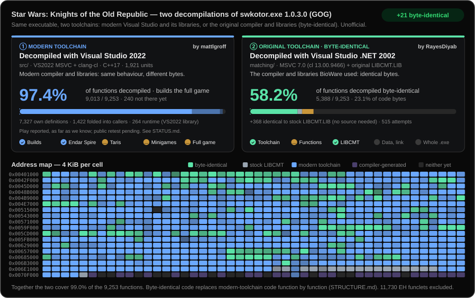

# Byte-identical decompilation (MSVC 7.0)

The byte-identical decompilation is the work of
[RayesDiyab](https://github.com/RayesDiyab). The modern-toolchain
decompilation in `src/` is the work of
[mattlgroff](https://github.com/mattlgroff).



This directory holds a second, independent track: C++ source that compiles
with the original toolchain to the **same machine code** as the GOG 1.03
`swkotor.exe`, function by function. It does not change or replace the
playable build under `src/` and is not part of `build.py`. How the two
builds relate, and the plan to bring matched code into the playable build, is
in [STRUCTURE.md](../STRUCTURE.md). To contribute, as a person or an AI agent, follow
[CONTRIBUTING.md](CONTRIBUTING.md).

`swkotor.exe`'s Rich header names the toolchain: Visual Studio .NET 2002
(MSVC 7.0, `cl` 13.00.9466), linked 2004-02-12. With that compiler and
`-O2 -Gy -GX`, every function annotated here is compared byte for byte with
the original.

## Status

When this directory was added, 5,756 functions were annotated and 5,252 of
them were byte-identical. The other 504 are best attempts (`NONMATCH`) kept
for later passes. Another 395 functions are identical to the stock
`LIBCMT.LIB` and need no source (see below). `status.csv` records every function's current result, and
the tracker above is rebuilt from it.

## Layout

- `src/<bucket>/*.cpp`: annotated sources. Each bucket (`a`..`n`) covers an
  address range of the executable. The buckets only exist so that parallel
  work never touched the same files. `src/pilot1..3` are the first
  experiments.
- `include/<bucket>/*.h`: class declarations in 2002-era style, with members
  at their original offsets, virtuals in vtable order, and callees declared
  but not defined.
- `tools/matchcmp.py`: the compile-and-compare tool.
- `tools/libmatch.py`, `crt_libcmt.csv`: stock library functions in the exe.
- `tools/symbolmap.py`, `symbols.csv`: symbol-to-address map, the bridge to
  the playable build.
- `tools/ppcnames.py`, `research/mac-ppc-names.md`: names and source files
  from the Mac PowerPC builds, paired by address, and what that found.
- `tools/render_banner.py`, `assets/progress.svg`: the progress tracker.
- `status.csv`, `functions.csv`: the tracker's inputs.

Some file comments cite paths in the upstream working repository
(`src/batches/...`, `docs/batches/worker-*-notes.md`, `reverse/functions.csv`)
or name the parallel worker that wrote them ("worker C"). These were
navigation notes there and have no counterpart here.

## Annotations

Each function to check carries a marker directly above its definition:

```cpp
// FUNCTION: SWKOTOR 0x00409460
int CExoResMan::Leaf9460(unsigned long a, int b, int c) { ... }
```

Templates, compiler-generated functions and overloads that the name lookup
cannot resolve add the decorated symbol:

```cpp
// FUNCTION: SWKOTOR 0x004233c0 SYMBOL: ??_GCAurTextureBasic@@UAEPAXI@Z
```

Bytes covered by a relocation in our object file (call targets, global
addresses) are masked on both sides. Everything else must be identical, and
the rest of the original function's range must be padding.

## Running the comparison

Requirements:

- Visual Studio .NET 2002 (MSVC 7.0) from your own licensed copy, with the
  directory that contains `BIN\CL.EXE` and `INCLUDE`. It is not
  redistributable and is not included here.
- Your purchased GOG 1.03 `swkotor.exe`, SHA-256
  `9c10e0450a6eeca417e036e3cde7474fed1f0a92aab018446d156944dea91435`, kept
  outside this checkout.
- Python with `pefile` (see [BUILDING.md](../BUILDING.md)).

```powershell
python .\matching\tools\matchcmp.py --msvc "C:\Tools\msvc7" --exe "D:\Games\Star Wars - KotOR\swkotor.exe" -q matching\src
```

- `-v` prints a side-by-side disassembly (original | ours) for misses, with
  `!!` marking the differing instructions.
- `--report matching/status.csv` writes one row per annotated function. It
  feeds the progress tracker; see below.
- Function ends come from `functions.csv` (the default `--function-table`),
  the annotations and the original's direct call targets. A function the
  table misses inside another one's range must be annotated too, or the
  outer function can't match.
- On Linux and macOS the compiler runs under Wine. `KOTOR_WINE` names the
  launcher.
- Use the dash form of the flags (`-O2`, not `/O2`) from Git Bash, which
  rewrites `/O2` into a path.

## Progress tracker

The tracker at the top of both READMEs, `matching/assets/progress.svg`,
shows the two decompilations side by side. They measure different things,
so they are never added together:

- **Modern toolchain** (blue, `src/`): decompiled C++ built with Visual
  Studio 2022 and its libraries. It behaves like the original, but the
  bytes differ. Its percentage counts three kinds of function:
  - those `src/` defines under their original address
    (`kotor_<cc>_<address>`)
  - those it only cites, because they are folded into a caller or shared
    with an identical function
  - C runtime functions that VS2022's library supplies

  What remains is code `src/` doesn't reference yet, such as the minigames
  and probable leftovers, plus tiny stubs. Its milestones
  restate [STATUS.md](../STATUS.md); update `PLAYABLE` in the script when
  that file changes.
- **Original toolchain, byte-identical** (green, `matching/`): decompiled
  with Visual Studio .NET 2002 (MSVC 7.0) and the original libraries, so it
  compiles to the original's exact bytes, from `status.csv`. Functions
  identical to the stock `LIBCMT.LIB` (grey) need no source.
- **Address map:** for every 4 KiB of the original code it shows what is
  byte-identical, what is stock library, what exists only in the modern-toolchain version,
  and what neither has yet.

It updates itself:

1. After a matching change, rerun the tool with
   `--report matching/status.csv` and commit that file with the sources.
2. The GitHub Actions workflow `update-progress-tracker.yml` runs
   `tools/render_banner.py` and commits the refreshed SVG. It does this on
   every push to `main` that changes `src/`, `matching/status.csv`,
   `matching/functions.csv`, `matching/crt_libcmt.csv`,
   `build-manifest.json` or the renderer. Its badge shows the change in
   byte-identical functions since the previous `status.csv`.

`matching/functions.csv` lists the executable's 20,397 function starts. It
holds addresses only, and `kind` is `eh` for the 11,730 compiler-generated
EH funclets, which are not counted. Annotated functions missing from the
list (585 today) are added to it, giving 9,252 functions in total.

## The C runtime: stock LIBCMT.LIB

The exe statically links the multi-threaded C runtime that ships with
VS.NET 2002, unmodified. `tools/libmatch.py` splits every function out of
the MSVC 7.0 `LIB\*.LIB` files, masks relocations and searches the exe:

```powershell
python .\matching\tools\libmatch.py "C:\Tools\msvc7\LIB\LIBCMT.LIB" "D:\Games\Star Wars - KotOR\swkotor.exe" out.csv
```

- In the CRT band (0x006FA390–0x0070C0A0 and 0x00713190–0x00713E80), 395 of
  447 functions and 74,341 of 76,288 bytes are identical to `LIBCMT.LIB`.
- The single-threaded `LIBC.LIB` matches less.
- The Rich header agrees: 166 C and 41 MASM objects were built with
  13.00.9466.
- `crt_libcmt.csv` keeps the hits that have a single placement. Functions
  under 6 bytes are skipped. The matching build will link the library
  instead of reconstructing these.
- The rest of the 0x006F0000+ range is not CRT: game code at
  0x006F0260–0x006FA390, and import thunks plus glue at
  0x0070C0A0–0x00713180.

## Symbol map

`tools/symbolmap.py` reads every byte-identical function's relocations
against the original and writes `symbols.csv`, which maps each symbol (the
mangled name, plus the readable form) to its original address. Roles:
`defines` (the matched function itself), `calls` and `data`. Symbols that
map to several addresses are left out and printed. Today that's 110: copies
of identical code in the original, or naming slips in headers. Phase 2 in
[STRUCTURE.md](../STRUCTURE.md) builds the playable-build bridge on this
file. Rerun it after merging matches:

```powershell
python .\matching\tools\symbolmap.py --msvc "C:\Tools\msvc7" --exe "D:\Games\Star Wars - KotOR\swkotor.exe"
```

## Names from the Mac PowerPC builds

Aspyr's Mac ports were built with GCC from the same source and kept their
symbol tables: C++ names with parameter types. The 2004 port (v1.03,
PowerPC) names about 10,300 functions; the 2009 port (v1.03e, universal
PowerPC/i386) names about 13,300 and adds a debug map with each function's
original source file. `tools/ppcnames.py` pairs those functions with the
original's addresses, so functions known only by address can get their
names. It needs your own copies of the Mac executables, runs on any OS and
does not need MSVC:

```powershell
python .\matching\tools\ppcnames.py --exe "D:\Games\Star Wars - KotOR\swkotor.exe" --ppc "<2004 app>\Contents\MacOS\Knights of the Old Republic" "<2009 app>\Contents\MacOS\XKOTOR" --out "D:\KotorBuilds\ppcnames-01"
python .\matching\tools\ppcnames.py ... --holdout 0.2      # precision of each signal
```

Either build works alone. Signals, in order: names this project already
proved (`status.csv`, `symbols.csv`) with compatible parameters, vtables
both builds name (unless a known pair contradicts the alignment), the exact
set of strings a function references, and the call graph around paired
functions (`calls` needs two distinct paired neighbours, `calls1` one).
Given both Mac builds, each is paired separately; a function they name
differently, including the same method with different parameters, is left
unnamed with both candidates listed. `--holdout` hides one seeded sample of
the name pairs from every build and reports precision and coverage per
build and combined. Treat a paired name as a strong lead, not proof:
confirm it against the code before annotating. `todo.py --names
matching/mac_names.csv` shows the name and source file next to each
unclaimed function. [research/mac-ppc-names.md](research/mac-ppc-names.md)
has the method, results and what the pairing found about this repository.
`python -m unittest discover -s matching/tools -p "test_*.py"` runs the
pairing's regression tests on synthetic inputs.

`matching/mac_names.csv` holds hints, kept apart from the proved names in
`symbols.csv`: for each game function, the Mac name, the signal, how many
builds agree, how a name pair's parameters agree (`exact`, `compatible`:
same count and kinds but different guessed types, `unknown`: the repo name
has none), the original source file and whether that came from the debug
map or only from the neighbouring functions;
`matching/link_order.csv` holds the runs of one source file's functions in
address order: the inferred original link order. `--repo` refreshes both
(run it with both builds after `status.csv` or `symbols.csv` change).
`--out` gets the full working set: `signature_rejects.csv` lists repo names
refused for their parameters, `pairs.csv` lists every game function with its status here,
its playable `src/` file, the repo's name, the Mac name, the signal, how
many builds agree, the original source file and the Mac addresses, and
`mac_unpaired.csv` lists Mac
functions without a Windows partner. The starts come from `functions.csv`
plus the addresses `status.csv` and `symbols.csv` name and the exe's
direct call targets; the summary counts the starts `functions.csv` lacks.

## Source-shape notes

These patterns made functions match:

- BioWare used inline getters heavily (`g_pRules->Get2DArrays()->...`). They
  change load order and register allocation.
- The `if` body is laid out first. Invert the condition to flip the layout.
- `if (a || b) return;` sometimes has to be two separate `if`s.
- Declare address-taken locals in the narrowest block; this decides their
  stack slots.
- Classes passed by value (`CResRef`) need a declared copy constructor.
- `#pragma pack(4)` is needed where an `__int64` member sits at a 4-aligned
  offset.
- An `fs:[0]` frame in the original means `-GX` plus a local object with a
  destructor.
- An empty-state SEH frame in a constructor: give the list member a sized
  constructor that contains a dead `new`.
- Recursive tree walkers: `#pragma inline_recursion(on)` plus a
  per-function `#pragma inline_depth(N)`, with N found by sweeping.
- If ECX stays live across a call to a function compiled earlier in the same
  `.cpp`, put the caller and callee in separate files.
- Copying a member into a local just before the call that takes it can
  change register allocation.
- Still unsolved; skip after two or three tries: cross-function register
  use, the placement of a merged `return 0` block, the else-after-return
  layout, and some x87 scheduling ties.
